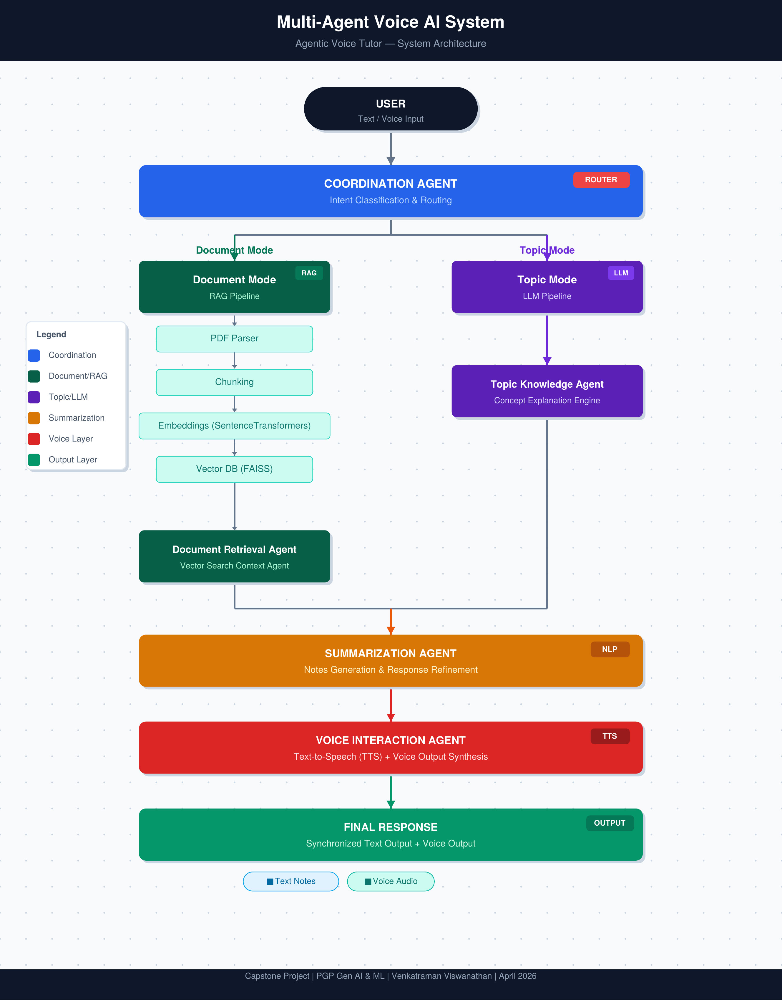

<h1 align="center">🎙️ Multi-Agent Hybrid Learning System</h1>

<i>Capstone research: architecture and design for a voice-based multi-agent learning system, using RAG, FAISS and autonomous agents</i>

  
  
  
  
  

  
  
  
  

---

A Multi-Agent Voice-Based AI System for Hybrid Learning using Retrieval-Augmented Generation (RAG), FAISS, and Autonomous AI Agents.

---

## Project Overview

This capstone project presents a multi-agent AI architecture designed to support hybrid learning through the integration of Retrieval-Augmented Generation (RAG) and modular agent-based intelligence.

The system enables users to learn from both user-provided documents and general topic queries by dynamically orchestrating specialized AI agents. Voice-based interaction capabilities further enhance the learning experience by enabling conversational and human-centric engagement.

---

## Project Documentation

📄 [Capstone Project Report](Agentic_AI_Voice_Capstone_Enhanced.pdf) · Archived on Zenodo: [doi.org/10.5281/zenodo.23439409](https://doi.org/10.5281/zenodo.23439409)

This repository contains the capstone report (Post Graduate Program in Generative AI & Machine Learning, April 2026; version 1.1 corrected October 2026 to document the prototype as built) and the architecture diagram. Implementation code is not included.

---

## Architecture Diagram

---

## Implementation Status (prototype, April 2026)

The diagram shows the five-agent conceptual design. The prototype implemented part of it:

| Component | Prototype implementation | Status |
|---|---|---|
| Coordination | Rule: Document mode if a PDF is uploaded, otherwise Topic mode | Rule-based; LLM intent routing planned |
| Document retrieval | pypdf, 500-word chunks, all-MiniLM-L6-v2 embeddings, FAISS top-3 | Implemented |
| Topic knowledge | Llama 3 (via Ollama) tutor agent without document context | Implemented (shared agent) |
| Summarization | Llama 3 notes step | Implemented |
| Voice | pyttsx3 spoken output on the host; text input only | Output implemented; speech input planned |
| Interface | Streamlit | Implemented |

No experimental evaluation has been carried out yet.

---

## Problem Statement

Traditional AI-powered learning systems often face several limitations:

* Limited adaptability across different learning contexts
* Inability to combine personal and global knowledge sources
* Lack of interactive and conversational capabilities
* Static response pipelines without intelligent routing

This project addresses these challenges through a multi-agent AI framework capable of dynamic interaction, intelligent orchestration, and adaptive knowledge delivery.

---

## Proposed Approach

This project proposes a multi-agent AI architecture for hybrid learning that integrates document-centric and open-domain knowledge retrieval with voice-enabled interaction.

Unlike conventional RAG systems, the proposed framework incorporates dynamic agent orchestration, enabling:

* Context-aware routing
* Adaptive response generation
* Modular scalability
* Intelligent knowledge retrieval

---

## Key Design Elements

### Dynamic Multi-Agent Orchestration

Specialized AI agents collaborate through a central coordination layer to intelligently process and route user requests.

### Hybrid Learning Framework

Supports both document-based learning and open-domain topic exploration within a unified platform.

### Voice-Based Interaction

Spoken output of each answer (pyttsx3) in the prototype; speech input is planned.

### Context-Aware Response Generation

Planned: responses adapted to user intent and conversation context. The prototype answers each query independently.

### Modular and Scalable Architecture

The framework allows agents to be extended, enhanced, or replaced without impacting overall system functionality.

---

## System Architecture

### Core Components

#### Coordination Agent

Acts as the central controller responsible for routing and orchestration of specialized agents. In the prototype, routing is rule-based (PDF uploaded: Document mode; otherwise Topic mode); LLM-based intent classification is planned.

#### Document Retrieval Agent

Processes uploaded documents and retrieves relevant information using Retrieval-Augmented Generation (RAG).

#### Topic Knowledge Agent

Handles general topic-based queries using a pre-trained LLM (prototype: the same Llama 3 tutor agent, without document context).

#### Summarization Agent

Generates concise explanations, learning summaries, and structured outputs.

#### Voice Interaction Agent

Converts generated responses into speech (prototype: pyttsx3, offline). Speech input and conversation history are planned.

---

## Workflow

1. User submits a text query and optionally uploads a PDF (voice input planned)
2. Coordination selects the mode (prototype: PDF uploaded means Document mode, otherwise Topic mode)
3. Query is routed to the matching agent
4. Relevant information is retrieved using RAG
5. Summarization Agent refines the response
6. Voice Interaction Agent generates audio output
7. Final response is delivered to the user

---

## Technology Stack

* Python
* Retrieval-Augmented Generation (RAG)
* FAISS Vector Database
* Large Language Models (LLMs)
* Agent-Based Architecture
* Llama 3 via Ollama
* Sentence Transformers (all-MiniLM-L6-v2)
* pyttsx3 text-to-speech
* Streamlit

---

## Key Features

* Multi-Agent Orchestration
* Hybrid Knowledge Retrieval
* Spoken answers (text-to-speech)
* Modular and Extensible Design

---

## Applications

* AI-Based Tutoring Systems
* Enterprise Knowledge Assistants
* Personalized Learning Platforms
* Corporate Training Systems
* Employee Onboarding Solutions
* Intelligent Learning Environments

---

## Research Alignment

This work relates to research in:

* Human-Centered AI Systems
* Generative AI for Learning
* Retrieval-Augmented Generation
* Multi-Agent AI Systems
* AI-Driven Decision Intelligence

---

## Future Enhancements

* Adaptive Learning Pathways
* Skill Gap Detection
* Reinforcement Learning-Based Feedback
* Multi-Language Voice Interaction
* Learning Analytics Dashboard
* Advanced Agent Collaboration

---

## Author

**Venkatraman Viswanathan**

PMP® | IEEE Senior Member | FRSA | FIETE

🌐 Website: https://venkatramanlabs.com

🔗 LinkedIn: https://linkedin.com/in/venkatraman-viswanathan-31985691

📚 Google Scholar: https://scholar.google.com/citations?user=nkQ-kXwAAAAJ&hl=en

🆔 ORCID: https://orcid.org/0009-0008-2889-7178
